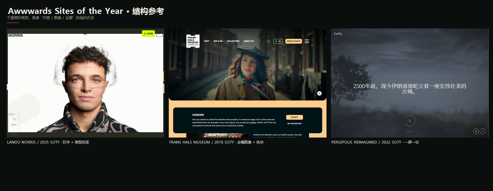
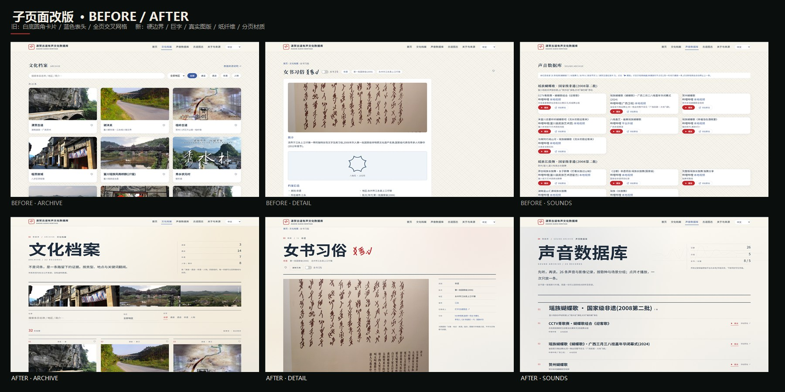
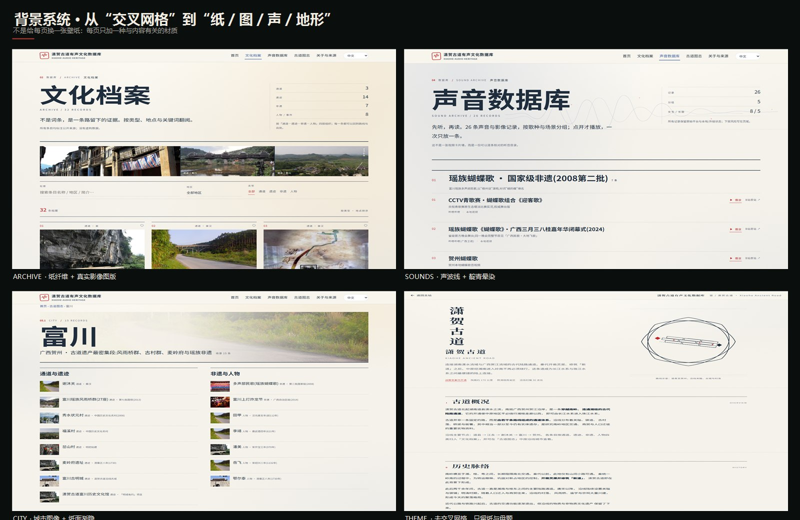

# 08 · 子页面改版与 Awwwards 参考

> 日期：2026-10-21  
> 范围：主站 `index.html` 的文化档案 / 详情 / 声音 / 图志 / 关于 / 城市页，以及 `themes/editorial.css` 覆盖的七个专题页。  
> 目标：把“白底圆角卡片 + 蓝色表头”的后台式界面，收回到首页的宣纸—朱砂—巨字系统里；不是换一套皮肤，而是把**档案的证据结构**摆到版面上。





---

## 一、为什么改

原主站子页面的问题不是“不好看”，而是**没有设计过**：

- 文化档案：3 列白卡 + 圆角 + hover 遮罩，像电商列表；
- 详情页：一个白卡里堆“简介 / 档案信息 / 要点”，右侧留白，像百科词条；
- 声音页：26 张白卡，每张一个红色胶囊按钮，像后台视频列表；
- 图志：地图 SVG 做得不错，但被放在一个大圆角框里，缺少图例与目录关系；
- 关于页：白卡 + 蓝色小标题；专题页：白卡 + 蓝色表头。

这些页面和首页的巨字、竖排引文、朱砂按钮、纸面底纹**不是一套语言**。  
改版的核心判断：**首页负责“进入”，子页面负责“核对”。** 子页面必须让人一眼看到：对象是什么、在哪里、凭什么、下一步去哪。

---

## 二、Awwwards Sites of the Year 参考

榜单：<https://www.awwwards.com/websites/sites_of_the_year/>

| 参考 | 年份 / 奖项 | 借用的结构 | 不照搬的部分 |
| --- | --- | --- | --- |
| [Lando Norris](https://landonorris.com/) | 2025 SOTY | 巨字与 10px 微型标签的尺度差；留白就是版面 | 人物摄影、荧光绿、3D 面罩 |
| [Frans Hals Museum](https://www.franshalsmuseum.nl/en/) | 2018 SOTY | 博物馆级全幅图像、平面色块、硬边界 | 视频头图、cookie 弹窗、英文无衬线体系 |
| [Persepolis Reimagined](https://persepolis.getty.edu/) | 2022 SOTY | 一屏一个句子、图像先行、圆形滚动提示 | 深色雾景、3D 遗址、声音开关 |
| [The Other Side of Truth](https://theothersideoftruth.com/) | 2022 SOTY | 调查报道式正文、出处与证据并列 | 暗色调查叙事、长文分章 |

补充参考来自 Awwwards **Culture & Education** 分类（<https://www.awwwards.com/websites/culture-education/>）：

| 参考 | 借用的结构 |
| --- | --- |
| [Los Angeles Public Library](https://www.lapl.org/) | 图书馆式暖纸底、社区影像头图、搜索与入口并置；档案页的“真实影像图版”来自这里 |
| [Hoyt Arts Center](https://www.hoytartscenter.org/) | 奶油纸底 + 深绿全幅图像 + 压在图像上的白纸信息板；城市页的图像头图参考 |
| [The Culture Index](https://culturetrends.siriusxmmedia.com/introduction) | 文化索引的章节节奏、编号与短标题 |

结论：**借“尺度 / 图像 / 证据”的组织方式，不借它们的视觉皮肤。** 宣纸、墨、朱砂、群青和八角连弧仍然是本项目的识别系统。

---

## 三、背景系统（2026-10-21 第二轮）

第一轮把页面从白卡改成了纸面，但全页仍铺着 45° 交叉网格，远看像工程草稿纸。第二轮把“背景”拆成四层，每页只取与内容有关的一层：

1. **纸纤维**：`--paper-fiber` 为程序化 SVG `feTurbulence` 噪声，200px 平铺；不再是规则线条。
2. **柔和晕染**：每页一组低透明度径向渐变；档案偏秋香、声音偏群青、城市偏暖金、关于偏朱砂。只用色温，不画形状。
3. **内容图版**：
   - 文化档案：三张真实沿线影像（临贺故城 / 风雨桥 / 古村）组成的 **图版**，替代装饰；
   - 声音数据库：`waveform.svg` 声波线，位于页头右侧，桌面可见、移动端隐藏；
   - 古道图志：`topo.svg` 等高线，低透明度铺在地图页；
   - 城市页：首条目的图像作为右侧头图，左侧用纸色渐隐保证文字可读；
   - 详情页：图像本身承担视觉重心，背景只保留极浅的朱砂/秋香晕染。
4. **专题页**：去掉 `hero::before` 的全页交叉网格，保留纸纤维与母题；`editorial.css` 统一覆盖。

原则：**背景不抢字，材质必须和内容有关。** 不用“国潮底纹”填满空白，也不把每页做成同一张壁纸。



---

## 三、改版后的版式规则

### 1. 标题

- 子页标题：`clamp(50px, 7.2vw, 104px)` 衬线；移动端 `clamp(40px, 10.5vw, 54px)`。
- 标题下必须有一行 10–11px、字距 0.3em 的英文/编号，形成“巨字—微标签”的落差。
- 页面编号：文化档案 `02`、详情 `03`、声音 `04`、图志 `05`、关于 `06`；城市 `05.1`。

### 2. 边界

- 取消白底、圆角、投影；改用 `1px solid var(--ink)` 的上边线 / 下边线。
- 卡片不再是“盒子”，而是“目录行”：编号、图、类目、标题、地点。
- 表格去掉蓝色表头与网格，改成只有上下横线的校勘表。

### 3. 版面

- 页头两栏：左标题 + 导语，右统计 / 索引；移动端上下堆叠。
- 详情页：全幅图像 + 右侧粘性元数据栏；正文与“关键事实”并置。
- 声音页：`编号 / 标题+说明+平台 / 播放+原站` 三列目录行；展开的播放器在第二列下方。
- 图志：地图 + 右侧“怎么读”；下方节点与城市都是目录，不是卡片墙。

### 4. 字体与颜色

沿用主站令牌：

```
--paper #F7F4EC   --ink #1F2D3D   --qun #3A5BA0
--cinnabar #C3272B   --gold #D9A13B   --tianshui #5CAC9E
--line rgba(31,45,61,.12)
```

不新增“国潮”色；Awwwards 参考只改变**尺度与边界**，不改变项目的地方色。

---

## 四、逐页改动

| 页面 | 旧 | 新 |
| --- | --- | --- |
| 文化档案 | 白卡网格、胶囊筛选、hover 遮罩 | 巨字页头 + 右统计；下划线检索/地区/类型；三列等宽编号目录卡；真实影像图版 |
| 详情 | 白卡 + 简介 + 信息列表 + 八角占位 | 巨字对象页；全幅图像；元数据栏；`它是什么 / 关键事实 / 出处 / 继续沿路`；复制引用 |
| 声音 | 26 张白卡 + 红色胶囊 | 5 组听音目录；编号、平台、本地/外链、播放/原站；展开行内播放器 |
| 图志 | 圆角地图框 + 节点卡 | 硬边界地图框 + 四角标记；图例；右侧读图说明；节点/城市目录 |
| 关于 | 白卡 + 蓝标题 | 双栏方法页；左侧范围/边界/多语，右侧 15 条来源编号 |
| 城市 | 浅蓝 banner + 白卡 | 巨字城市页头；左右两栏“通道与遗迹 / 非遗与人物”目录 |
| 专题页 | 白卡 + 蓝色表头 + 圆角页脚 | `editorial.css`：去白卡/圆角/投影；细线表格；页脚专题索引改为上边线 |

文案也同步改成“编辑体”，不再写“简介 / 档案信息”这种百科式标签：

- 档案：**“不是词条，是一条路留下的证据。”**
- 详情：**“它是什么 / 关键事实 / 出处 / 继续沿路”**
- 声音：**“先听，再读。”**
- 图志：**“地图是目录，不是插图。”**
- 关于：**“一个可以核对的数据库，不是一本宣传册。”**

---

## 五、实现

- 新样式集中在 `index.html` 的 `子页面 · 编辑型档案界面` 注释块，类名前缀 `ed-`，不覆盖首页的 `.hero`、`.topic-row`、`.mq-*`。
- 专题页覆盖集中在 `themes/editorial.css`，在七页 `</style>` 之后引入；`gen_themes.py` 重写页面后需要重新插入这一行。
- 详情页不再使用旧的 `.detail-head` flex 容器；`bindDetail` 改为 `.ed-detail-hero .fav-btn`。
- 新增 `ed(zh,en)`：中文环境用中文，其他语言回退英文，避免新增文案在日/韩/法/西/俄界面出现 `undefined`。
- 新增 `showToast` 与“复制引用”，引用格式：站点名 + 条目名 + 当前 URL。
- 声音页保留原有互斥播放逻辑；只改 DOM 结构和按钮状态，不引入自动播放。

---

## 六、验收清单

- [x] 1440×1000：档案 / 详情 / 声音 / 图志 / 关于 / 城市
- [x] 1024×900 / 768×900：页头两栏在 900px 以下收成单栏；标题、统计、筛选不挤压
- [x] 390×844（Chrome CDP 设备模拟）：以上六页；`scrollWidth = 390`，无横向溢出；移动端标题、统计、筛选、目录行重新排过
- [x] 专题页 01 / 02：白卡、蓝表头、圆角页脚已去除；hero 不再铺全页交叉网格
- [x] 背景系统：纸纤维 + 分页晕染 + 档案图版 / 声波线 / 等高线 / 城市图像；不再全页交叉线
- [x] 档案筛选、收藏、详情女书开关、复制引用、声音播放/收起、图志城市跳转的 DOM 入口保留
- [x] 主站 `index.html` 脚本 `node --check` 通过
- [x] 22 个静态 id 无重复，内部锚点无缺失，本地图片引用 5 个
- [ ] `gen_themes.py` 重跑后需补 `editorial.css` 引用
- [ ] 英文/日韩法西俄界面下新增编辑文案目前回退英文；后续可补五语词条

---

## 七、参考与依据

- Awwwards Sites of the Year：<https://www.awwwards.com/websites/sites_of_the_year/>
- 项目纹样与主题页说明：`docs/06-技术方案/06-主页纹样与主题页设计说明.md`
- 网页实现规范：`docs/06-技术方案/07-网页实现规范.md`
- 元数据分类参考：刘美杏、徐芳《古道文化遗产信息资源元数据标准制定——以潇贺古道为例》，《情报资料工作》2019 年第 4 期。
- 声音档案结构参考：中国艺术研究院“世界的记忆——中国传统音乐录音档案”数字平台（资源 / 专题 / 专栏）。
